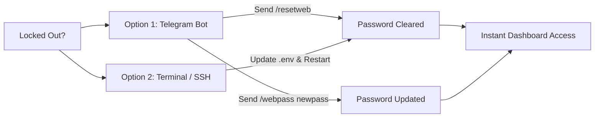

<div align="center">

# 🎬 telDownloader

### Next-Generation Automated Telegram Media Ingestion Engine & Live Monitor

[](LICENSE)
[](docker-compose.yml)
[](Dockerfile)
[](https://fastapi.tiangolo.com)
[](https://github.com/LonamiWebs/Telethon)
[](https://jellyfin.org)

<p align="center">
  <b>Seamlessly bridge Telegram directly to your Jellyfin and Plex libraries.</b><br>
  Zero-click media parsing, automated multi-episode indexing, container stream recovery, multi-gigabyte MTProto downloads, and a live WebSocket web dashboard.
</p>

[Key Features](#-key-features) • [Why telDownloader?](#-why-teldownloader) • [Architecture](#-system-architecture) • [Quick Start](#-quick-start) • [Web Dashboard](#-web-dashboard) • [Commands](#-telegram-bot-commands) • [License](#-license)

---

</div>

## 🌟 Key Features

### ⚡ Smart Ingestion Pipeline
- **Zero-Click TV Parsing**: Drop raw show releases into Telegram. The engine automatically filters scene tags, identifies the series title, extracts season and episode numbers, and organizes files into clean directory hierarchies:
  $$\text{House.of.the.Dragon.S02E02.1080p.HEVC.mkv} \longrightarrow \text{Shows/House of the Dragon/Season 02/s02e02.mkv}$$
- **Multi-Episode Detection**: Automatically detects combined episodes (e.g. `Friends.S10E17.E18...` $\rightarrow$ `s10e17-e18.mkv`) and increments library counters without desync.
- **Corrupt Extension Recovery (`ffprobe`)**: Recovers videos truncated by Telegram file naming limits (e.g. `.10`, `.HEV`, `.[@S`, `.H`, `.WEB-`) by inspecting the underlying bitstream container, ensuring valid `.mkv` or `.mp4` packaging.
- **Bypass Telegram File Size Limits**: Leverages an MTProto user client (`Telethon`) to download multi-gigabyte video files (>2 GB / 4 GB) at unthrottled speeds.
- **Instant Media Server Webhooks**: Silently triggers background library scans on **Jellyfin** (`POST /Library/Refresh`) and **Plex** (`GET /library/sections/all/refresh`) the millisecond a file move completes.
- **Collision & Overwrite Guard**: Intelligently prompts confirmation before overwriting duplicate files or existing episodes.

---

### 🖥️ Modern Web Dashboard (`:8088`)
- **Real-Time Telemetry**: Live WebSocket connection (`/ws/downloads`) streaming transfer rates, progress percentages, transferred bytes, and precise time-to-completion (ETA).
- **Library Browser & File Manager**: Browse ingested movies and series directly from the browser, with one-click deletion and disk reclamation.
- **Dynamic Live Configuration**: Update API credentials, folder paths, and log levels directly through the UI without restarting the container or manually editing `.env`.
- **Credential Masking**: Sensitive tokens (Bot Token, User ID, API ID, API Hash, Passwords) are masked by default with show/hide toggle controls (`👁️` / `🙈`).
- **Session Authentication**: Secured by HTTP-only session cookies (`tel_session`) with preconfigured out-of-the-box open setup and optional instant password protection.

---

### 🛡️ Hardened Security & Remote Admin
- **Strict Identity Guard**: Restricts bot execution strictly to your authorized numeric `ADMIN_USER_ID`. Unknown users are ignored.
- **Emergency Remote Password Recovery**: If you forget your web password, reset or update it instantly from your Telegram admin chat (`/resetweb` or `/webpass <password>`).

---

## ⚖️ Why telDownloader?

| Capability | Standard Telegram Bots | telDownloader |
| :--- | :---: | :---: |
| **Download Size Limit** | 20 MB – 50 MB (Bot API) | **Unlimited (MTProto > 4 GB)** |
| **TV Show Renaming** | Manual rename required | **Zero-Click Regex Engine** |
| **Multi-Episode Support** | ❌ Fails or misnames | **✅ Automated (`s01e01-e02`)** |
| **Truncated Extension Fix** | ❌ Broken video file | **✅ Deep stream probe (`ffprobe`)** |
| **Media Server Integration** | ❌ Manual rescan | **✅ Instant Jellyfin & Plex webhooks** |
| **Live Transfer Speed & ETA** | ❌ None | **✅ Real-time WebSocket Dashboard** |
| **Database Architecture** | Heavy external databases | **Zero-maintenance embedded SQLite** |
| **Container Footprint** | Multi-container compose | **Single ultra-light container** |

---

## 🏛️ System Architecture

```text
 ┌────────────────────────────────────────────────────────────────────────┐
 │                              TELEGRAM CLOUD                            │
 └───────────────────▲────────────────────────────────▲───────────────────┘
                     │ MTProto Protocol               │ Bot API Webhooks
                     │ (Telethon Client)              │ (python-telegram-bot)
 ┌───────────────────▼────────────────────────────────▼───────────────────┐
 │                     telDownloader Single Container                     │
 │                                                                        │
 │   ┌────────────────────────┐             ┌─────────────────────────┐   │
 │   │   Telegram Bot Core    │             │   FastAPI Web Engine    │   │
 │   │  Interactive Handlers  │             │   Port 8088 / WebSocket │   │
 │   └───────────┬────────────┘             └────────────┬────────────┘   │
 │               │                                       │                │
 │               ▼                                       ▼                │
 │   ┌────────────────────────────────────────────────────────────────┐   │
 │   │                     Embedded SQLite Storage                    │   │
 │   │            (/app/data/media_data.db • aiosqlite)               │   │
 │   └───────────────────────────┬────────────────────────────────────┘   │
 │                               │                                        │
 │                               ▼                                        │
 │   ┌────────────────────────────────────────────────────────────────┐   │
 │   │                   Stream & Metadata Pipeline                   │   │
 │   │              FFmpeg / FFprobe Container Inspection             │   │
 │   └───────────────────────────┬────────────────────────────────────┘   │
 └───────────────────────────────┼────────────────────────────────────────┘
                                 │
                                 ▼ Host Volume Mounts
       ┌─────────────────────────┴─────────────────────────┐
       ▼                                                   ▼
┌──────────────┐                                    ┌──────────────┐
│   MOVIES/    │                                    │    SHOWS/    │
│ Jellyfin/Plex│                                    │ Jellyfin/Plex│
└──────────────┘                                    └──────────────┘
```

---

## 🚀 Quick Start

### Prerequisites
- [Docker](https://docs.docker.com/engine/install/) & [Docker Compose](https://docs.docker.com/compose/)
- Telegram API Credentials from [my.telegram.org](https://my.telegram.org)
- Telegram Bot Token from [@BotFather](https://t.me/BotFather)

### 1. Clone Repository
```bash
git clone https://github.com/shahid-tk/telDownloader-.git telDownloader
cd telDownloader
cp .env.example .env
```

### 2. Configure Environment (`.env`)
Populate `.env` with your primary parameters:

```env
# Core Telegram Credentials
BOT_TOKEN=123456789:ABCDefghIJKLmnopQRSTuvwxYZ
ADMIN_USER_ID=123456789

# Telegram MTProto API Credentials (https://my.telegram.org)
API_ID=12345678
API_HASH=0123456789abcdef0123456789abcdef

# Host Storage Mounts
MOVIES_DIR=/path/to/media/movies
SHOWS_DIR=/path/to/media/shows

# Web Interface
WEB_PORT=8088
WEB_USERNAME=admin
WEB_PASSWORD=

# Optional Media Server Auto-Scan
JELLYFIN_URL=http://jellyfin:8096
JELLYFIN_API_KEY=your_jellyfin_token
PLEX_URL=http://plex:32400
PLEX_TOKEN=your_plex_token
```

### 3. Generate Telethon Session (One-Time Setup)
Create your MTProto user authorization session interactively:
```bash
docker compose run --rm bot python create_session.py
```
*Enter your phone number and the Telegram login verification code. The session is safely saved to `./data/telethon.session`.*

### 4. Deploy
```bash
docker compose up -d --build
```

### 5. Access Dashboard
Navigate to:
```text
http://<server-ip>:8088/
```
- **Default Username**: `admin`
- **Default Password**: *(leave blank on first login)*
- Open the **Configuration** tab to customize folder paths or secure the dashboard with a password anytime.

---

## 🤖 Telegram Bot Commands

| Command | Action |
| :--- | :--- |
| `/start` | Launch interactive menu and select ingestion mode (Movies / Shows) |
| `/status` | View active download telemetry, transfer speeds, and session status |
| `/cancel` | Immediately cancel and abort the active download |
| `/stop` | Finalize and complete the active TV show upload session |
| `/delete` | Launch interactive visual browser to inspect and delete library media |
| `/resetweb` | Instantly reset the web dashboard password back to default open access |
| `/webpass <pwd>` | Update or set the web dashboard password directly from Telegram |
| `/help` | Display command usage and navigation help |

---

## 🔐 Password Recovery & Administration

If you ever lock yourself out or forget the web dashboard password:



- **Instant Telegram Reset (Fastest)**: Send `/resetweb` to your bot in Telegram. The bot immediately clears the password in `.env` and notifies you in chat.
- **Direct Terminal Reset**:
  ```bash
  sed -i 's/^WEB_PASSWORD=.*/WEB_PASSWORD=/' .env && docker compose restart bot
  ```

---

## 📂 Project Structure

```text
telDownloader/
├── app/
│   ├── bot.py                  # Core application runner (Bot + FastAPI concurrent loop)
│   ├── config.py               # Pydantic environment validation & settings manager
│   ├── create_session.py       # One-time interactive Telethon session generator
│   ├── database/
│   │   ├── sqlite.py           # Embedded SQLite async connection & schema manager
│   │   └── repositories/       # User, Session, and Upload persistence layers
│   ├── handlers/               # Command handlers (start, movie, show, status, delete, auth)
│   ├── services/
│   │   ├── download_tracker.py # WebSocket real-time progress & metrics broadcaster
│   │   ├── media_service.py    # Filename normalization, container probing, file moving
│   │   ├── media_server.py     # Background Jellyfin & Plex scan webhooks
│   │   └── telethon_service.py # MTProto client wrapper with reconnect intelligence
│   └── web/
│       └── server.py           # FastAPI dashboard, session auth & WebSocket API
├── data/                       # Persistent volume: SQLite DB & Telethon sessions
├── logs/                       # Application runtime logs
├── docker-compose.yml          # Container configuration
├── Dockerfile                  # Slim Python 3.12 image with FFmpeg toolchain
├── requirements.txt            # Locked Python production dependencies
└── .env.example                # Sample environment configuration template
```

---

## 🤝 Contributing

Contributions, bug reports, and feature suggestions are welcome!

1. Fork the Project
2. Create your Feature Branch (`git checkout -b feature/AmazingFeature`)
3. Commit your Changes (`git commit -m 'feat: Add AmazingFeature'`)
4. Push to the Branch (`git push origin feature/AmazingFeature`)
5. Open a Pull Request

---

## 📄 License

Distributed under the **MIT License**. See [`LICENSE`](LICENSE) for more information.

<div align="center">
  <sub>Built with ❤️ for self-hosted home-lab enthusiasts.</sub>
</div>
